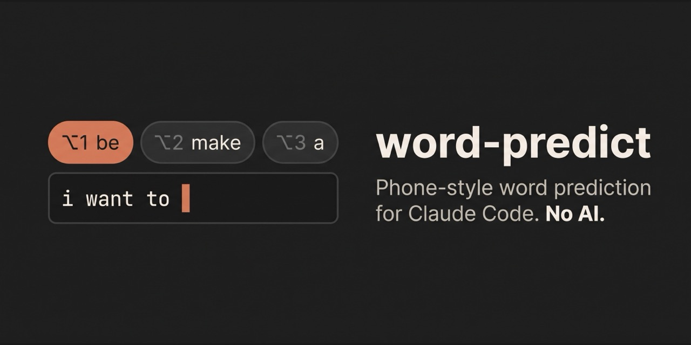

# word-predict



Phone-keyboard word prediction for the [Claude Code](https://claude.com/claude-code)
prompt box. No AI: it finishes the word you are typing and suggests the next one
from an English word list and from the way you write.

## Install

In a Claude Code session, run:

```
/plugin install word-predict --marketplace tehwave/claude-word-predict
```

Answer `y` to add the marketplace, then pick a scope. On its first start the mod
downloads its word list (about 10 MB, once) and says when it is ready. Then tell it
your keyboard layout, so Option+1/2/3 work:

```
/predict layout danish
```

(`us`, `danish`, `german` or `british`; `us` until you set one.)

## Use

- **A strip above the prompt** shows three words: ways to finish the word you
  are typing, or likely next words after a space.
- **Option+1, Option+2, Option+3** take the first, second or third word while the
  strip shows. Press the same key again right away to type its own character
  instead. You can also click a word.
- **It learns as you go.** Words and word pairs from the prompts you send move
  up. A word the list doesn't know is offered once you have used it twice. Code
  blocks, inline code and paths are skipped.

| Command | What it does |
| --- | --- |
| `/predict` | Shows what it knows |
| `/predict import` | Learns from the prompts you typed in past sessions (needs `python3`) |
| `/predict forget` | Clears everything it learned from your prompts |
| `/predict layout <name>` | Sets which Option keys take a word: `us`, `danish`, `german`, `british` |
| `/predict off`, `/predict on` | Turns prediction off and on, in every session |

`/predict import` gives the biggest improvement: suggestions start sounding like
you. It runs [`scripts/import_history.py`](scripts/import_history.py), which reads
your local session transcripts (`~/.claude/projects`), counts which words follow
which in what you typed (not Claude's summaries or the app's own notes), and keeps
only those counts. Nothing leaves your machine.

## Keyboard layouts

The desktop app keeps Tab, the arrow keys and Ctrl shortcuts for itself, so the
mod reads Option+1, 2 and 3 by the character each one types on your layout and
swaps that character for the word. Only your own layout's three characters
count, so your other Option characters (€, £, “, …) type as usual. The US,
Danish, German and British Mac layouts are known (`LAYOUTS` in
[`hooks/keys.ts`](hooks/keys.ts)). For another layout, add what its Option+1, 2
and 3 type, and send a pull request.

## Where the word list comes from

The English word and word-pair counts are Peter Norvig's
[n-gram data](https://norvig.com/ngrams/), derived from the Google Web Trillion
Word Corpus. This repository does not include them: each install downloads them
from norvig.com and builds its list locally ([`hooks/lexicon.ts`](hooks/lexicon.ts)).
The download is checked against the SHA-256 of the exact files the mod was
tested with, so a changed or tampered file is refused rather than used.

## Privacy

What the mod reads, sends, runs and keeps.

**Network.** The mod contacts one host, `www.norvig.com`, and only to download
two public files: `https://www.norvig.com/ngrams/count_1w.txt` and
`https://www.norvig.com/ngrams/count_2w.txt`. Each is fetched with plain `GET`
requests carrying a `Range` header, in pieces below Claude Code's 4 MiB response
limit. It sends nothing else: no prompts, no words, no identifiers. This happens
once, on the first session start (and again only if a new version changes how
the list is built). After that it makes no network requests.

**Programs.** The mod runs one program, and only when you type `/predict
import`: `python3 -I <plugin folder>/scripts/import_history.py`. Python is
needed because the session transcripts it counts are often larger than a mod
may read directly. The script reads your local session transcripts under
`~/.claude/projects` (or `$CLAUDE_CONFIG_DIR/projects`), keeps only what you
typed, and prints word-sequence counts; the mod stores those counts and nothing
else. The script writes no files and opens no network connections.

**What it keeps.** Everything is kept in the plugin's own Claude Code store on
your machine: the built word list, the counts from `/predict import`, word
counts from prompts you send, and your `/predict` settings. `/predict forget`
deletes the counts.

**Hooks.**

| Hook | What it does |
| --- | --- |
| `session.start` | Loads the stored data, registers `/predict`, and downloads the word list if it's missing or out of date |
| `prompt.edit` | Reads each edit in the prompt box to update the suggestions. When the edit is your layout's Option+1/2/3 and a suggestion is showing, it replaces that key's character with the word; every other edit passes through unchanged |
| `prompt.change` | Updates the suggestions when the box changes in other ways (history, clear, paste) |
| `prompt.submit` | After a prompt is sent, counts its words and word pairs (not code, paths or prompts another hook refused) into the local store. Prompts submitted by other plugins pass through it too and are counted the same way; it never changes or blocks a prompt |
| `command.run` | Answers `/predict` |
| `ui.render` | Draws the suggestion strip above the prompt |

## Develop

```
claude --plugin-dir .
```

Check and test it with `claude plugin validate .` and `claude plugin test .`.

## License

[MIT](LICENSE)
